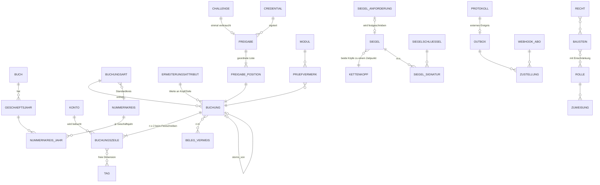

# Datenmodell, Fassung 4: drei Ebenen, Kern eines Buchs, Module

Stand: 2026-11-22, kumero 0.7.79. **Beschrieben ist, was gebaut ist** – abgeleitet aus den Migrationen in `db/verwaltung/`,
`db/mandant/`, `db/migrationen/` und `module/*/migrationen/`, nicht aus den Entwürfen. Was nur geplant ist, steht
getrennt in Abschnitt 8; wo der gebaute Stand von einer früheren Beschreibung abweicht, in Abschnitt 9.
Das Modell bleibt abstrakt: Entitäten, Beziehungen und Regeln, keine DDL. Maßgeblich für die Entscheidungen ist AGENTS.md.

Fassungen: 3 freigegeben am 2026-11-13 (Kern 0.2.0), 3.1 Beitrag zur Jahressperre, 3.2 Merkmale der Rechte und Empfänger
(Kern 0.4.0). **Fassung 4 zieht nach, was seither gebaut wurde:** Belegverweis als Link (F88), Nutzer im Mandanten (F114),
Siegel auf Anforderung (F120, F124), mehrere Bücher je Mandant (F126), Module und Rollen am Mandanten (F135), Module
schalten (F142, F143) und alle Module. Nachgetragen in dieser Fassung: Art „fremd“ und Kostenstelle am Anlagegut
(0.7.72), Artikelgruppen (0.7.73) mit ihrer Aufgabe (0.7.83, F189), **Adresse des Mandanten und Widerruf aller Passkeys beim Wechsel (0.7.79, F181)** –
Verwaltung bis Migration 0008, Mandant bis 0005. Die Abschnitte 2 bis 4 beschreiben den **Kern eines Buchs**; sie sind aus
Fassung 3.2 übernommen und berichtigt.

---

## 0. Drei Ebenen

| Ebene | Datenbank | Schema | Was dort liegt | Wer schreibt |
|---|---|---|---|---|
| **Installation** | `kumero_verwaltung` | `verwaltung` | Liste der Mandanten und ihrer Bücher mit den Namen der Datenbanken, Zuordnung Pseudonym → Mandant, System-Verwalter, Aufträge an den Dienst, Wasserstandsmarken. **Keine Buchungsdaten, keine Nutzer der Mandanten, keine Rollen.** | Anwendung nur über Funktionen; Datenbanken anlegen, sichern und löschen nur der Dienst `kumero-auftraege` als `kumero_owner` (F118) |
| **Mandant** | `kumero_<mandant>` | `mandant` + je Modul am Mandanten ein Schema | Wer hier arbeitet (Nutzer, Anmelde-Passkeys, Zugänge, Sitzungen, Einstellungen), Administratoren, Liste der Bücher, Module/Rechte/Rollen am Mandanten, eigene Protokollkette | Anwendung nur über Funktionen |
| **Buch** | `kumero_<mandant>__<buch>` | `kern` + je Modul des Buchs ein Schema | Die Buchhaltung: Stammdaten, Buchungen, Freigaben, zwei Ketten, Siegel, Rechte und Rollen des Buchs | Anwendung nur über Funktionen (F64) |

Regeln zwischen den Ebenen:

- **Keine Fremdschlüssel über Datenbankgrenzen.** Ein Nutzer erscheint im Buch nur als Subjekt `nutzer:<uuid>`; ein Buch
  kennt seinen Mandanten nur als Kennung.
- **Eine Transaktion bleibt in einer Datenbank** (BUECHER.md A8). Was zwei Ebenen berührt, läuft in fester Reihenfolge
  und verträgt den Abbruch dazwischen.
- **Ein Modul gehört zu einer Ebene** (F135): Buch (Vorgabe) oder Mandant. Ein Modul des Buchs liest am Mandanten nichts;
  es fragt über `Dienste::auskunftAmMandanten()` und bekommt nur ID und Anzeigenamen.
- **Module lesen einander nicht** (F44): eigenes Schema, Zugriff auf Kern und andere Module nur über die Modul-API.
- **Pfade** folgen den Ebenen: `/api/v1/…` (Installation), `/m/{mandant}/api/v1/…` (Mandant),
  `/m/{mandant}/b/{buch}/api/v1/…` (Buch).
- Jede Ebene hat ihre **eigene Protokollkette**: Verwaltung, Mandant und – je Buch – die Ketten 1 und 2.

---

## 1. Kern eines Buchs – Überblick

| Gruppe | Entitäten |
|---|---|
| A. Stammdaten | Buch, Konto, Tag, Buchungsart, Nummernkreis, Nummernkreis-Jahr, Geschäftsjahr, Beitrag zur Jahressperre, Modul, Modul-Rollenbaustein, Erweiterungsattribut |
| B. Buchungen | Buchung (Kopf), Buchungszeile, Zeile↔Tag, Erweiterungswerte, Prüfvermerk, Belegverweis |
| C. Freigabe | Credential, Challenge, Freigabe, Freigabe-Position |
| D. Nachweis | Protokoll (Kette 2), Kettenkopf, Siegel, Siegel-Anforderung, Siegel-Signatur, Siegelschlüssel; angelegt und ungenutzt: Siegel-Export, Restore-Prüfung |
| E. Integration | Outbox, Webhook-Abo, Zustellung, Empfänger, Idempotenz |
| F. Rechte | Recht, Baustein, Rolle, Zuweisung – je Buch |

---

## 2. Kern eines Buchs – Entitäten

### A. Stammdaten

**Buch**: genau eine Zeile je Datenbank (F126)
- **Kennung** (im Mandanten eindeutig, steht im Pfad), Name, **Art** (EÜR oder Bilanz – der Kern bleibt doppisch, F9), **Testbuch** ja/nein (ein Testbuch wird nie produktiv)
- **Buchwährung** (ISO 4217, F11; unveränderlich ab der ersten Festschreibung), Sprache; der Stempelabstand aus F28 steht noch als Feld da und wird seit F119 nicht mehr verwendet
- **Betriebsart**: Test oder Produktiv (F59; der Wechsel zu Produktiv ist einmalig und nicht umkehrbar)
- **Zugriffszustand**: normal oder Lesemodus (F60, z. B. nach einem Restore bis zur bestandenen Prüfung)

**Konto** (F2, F5, F7)
- Kontonummer (eindeutig, Text), Bezeichnung, **Kontoart** (Aktiv / Passiv / Aufwand / Ertrag), aktiv ja/nein
- Die Kontoart ist nur änderbar, solange keine festgeschriebene Buchung das Konto nutzt. Konten werden nie gelöscht.

**Tag** (F8, F51): Name (eindeutig), Herkunft (manuell / paperless), Paperless-ID (optional)

**Buchungsart** (F25): Kürzel, Bezeichnung, Standard-Nummernkreis

**Nummernkreis** (F25): Kürzel, Bezeichnung

**Nummernkreis-Jahr** (F25)
- Nummernkreis × Geschäftsjahr: Formatvorlage, Regel zum Zurücksetzen (neu oder fortlaufend), Startwert, **Zählerstand**
- Unveränderlich ab der ersten Vergabe.

**Geschäftsjahr** (F33, F36, F65)
- Kennung, **Beginn und Ende frei konfigurierbar** (abweichendes Wirtschaftsjahr, Rumpfgeschäftsjahr)
- Zeiträume ohne Überschneidung und lückenlos aneinander anschließend
- Status: offen / gesperrt; mehrere Jahre dürfen gleichzeitig offen sein

**Modul** (F44, F72, F142): Registry der Module dieses Buchs mit Name, Version und aktiv ja/nein. Die Datenbank nutzt sie, um vorgeschriebene Prüfvermerke zu verlangen. Ausschalten setzt nur „aktiv“ auf nein; Daten und Schema des Moduls bleiben.

**Modul-Rollenbaustein** (F143): Modul × Rolle × Baustein, gegeben am. Merkt, welchen Baustein ein Modul einer Rolle schon einmal gegeben hat – was der Administrator einer Rolle nimmt, kommt beim Nachziehen nicht zurück.

**Beitrag zur Jahressperre** (F75 Nr. 11, Fassung 3.1): Geschäftsjahr × Modul → Modulversion, Hash des Moduldatenstands, gesetzt am/von. Pflicht für jedes aktive Modul mit Erweiterungspunkt `gj_sperren_beitrag`, Teil des Sperrinhalts, nach der Sperre unveränderlich.

**Erweiterungsattribut** (F58): die Registry der von Modulen angemeldeten Zusatzfelder
- Schlüssel mit Namensraum (z. B. `steuer.satz`), Modul, Ebene (Kopf / Zeile), Datentyp (Text, Datum, Dezimal-String, Ganzzahl, Wahrheitswert, Auswahl), Pflicht beim Festschreiben ja/nein

### B. Buchungen

**Buchung**, der Kopf (F26)

| Attribut | Pflicht | Hinweis |
|---|---|---|
| ID (UUID) | ja | |
| Buchungsart, Nummernkreis | im Entwurf nein, beim Festschreiben ja | F62 |
| Status | ja | entwurf / **freigabebereit** / festgeschrieben (F66) |
| Belegdatum, Buchungsdatum | beim Festschreiben | das Buchungsdatum bestimmt das Geschäftsjahr |
| Belegnummer | nein | Freitext |
| Text | beim Festschreiben | |
| Herkunft, Herkunftsreferenz | ja / nein | |
| Storno von | nein | eindeutig |
| erfasst am/von | ja | |
| *bei festgeschriebenen Buchungen:* | | |
| Journalnummer | ja | Kette 1, lückenlos, endlos |
| Nummer (Zahl + formatiert) | ja | je Kreis lückenlos |
| festgeschrieben am/von | ja | |
| **Freigabe** | ja (im Produktivbetrieb) | Verweis auf die Freigabe (C) |
| vorbereitet am/von | bei freigabebereit | F66 |
| **Freigabe-Hash** | ab freigabebereit | RFC 8785 über den eingefrorenen Inhalt **ohne** Kettenfelder |
| Vorgänger-Hash, Hash | ja | Hash = SHA-256(Vorgänger-Hash ‖ JCS(Inhalt + Freigabe-Hash + Freigabe-Signatur)) |

**Buchungszeile** (F4, F12, F24)
- Position, Konto, Seite (S/H), Betrag (> 0); optional die Fremdwährungsangaben (alle Angaben zusammen)
- In Entwürfen dürfen einzelne Angaben fehlen (F62).

**Zeile ↔ Tag** (F8)

**Erweiterungswert** (F58): Buchung (bzw. Zeile) × Erweiterungsattribut → Wert
- Wird beim Festschreiben vom Modul geprüft (synchroner Erweiterungspunkt, F46).
- Ist **Teil des Inhalts und damit des Hashes**.
- Werte, die auf veränderliche Stammdaten verweisen, werden als Momentaufnahme gespeichert (z. B. `steuer.schluessel` **und** `steuer.satz`).

**Prüfvermerk** (F72): Buchung × Modul → Modulversion, Erweiterungspunkt (anreichern / prüfen), Ergebnis, Zeitpunkt. Ohne einen positiven Prüfvermerk jedes aktiven Moduls mit „Festschreiben prüfen“ lehnt die Datenbank das Festschreiben ab. Prüfvermerke werden Teil des Hashes.

**Belegverweis** (F10, F27)
- Buchung, **Link** (ganzer Link auf den Beleg, F88; bei Altbestand vor 0.7.2 stattdessen die Paperless-ID), MD5, SHA-256, zugeordnet am/von, Art (bei Festschreibung / nachgereicht)
- Link: `http`/`https`, Host klein, ohne Zugangsdaten, Abfrage und Fragment, höchstens 500 Zeichen; je Buchung eindeutig.
- MD5 und SHA-256 dürfen gemeinsam fehlen (ungeprüfter Verweis); vorbereitet, festgeschrieben und nachgereicht wird das nur im Testbetrieb.
- Belege „bei Festschreibung“ sind Teil des Inhalts. Nachgereichte Belege stehen im Protokoll. Ein Verweis wird nie entfernt.

### C. Freigabe (F38)

**Credential** (Freigabe-Passkey, getrennt vom Anmelde-Passkey im Mandanten): ein registrierter Passkey oder YubiKey eines Nutzers. Dienstkonten geben nie frei (F78)
- Subjekt (Nutzer- oder Client-ID), Credential-ID, öffentlicher Schlüssel, Algorithmus, Bezeichnung (z. B. „YubiKey Büro“)
- registriert am, widerrufen am
- Registrierung und Widerruf sind Protokollereignisse. Ein Credential wird nie gelöscht.

**Challenge** (F68): eine vom Server ausgegebene, **einmal verwendbare** Anforderung
- ID, einmaliger Zufallswert (≥ 32 Byte), Ablaufzeit (Standard 5 Min.), Mandant, Art der Handlung, Subjekt, Inhalts-Hash
- Challenge-Wert = SHA-256(JCS der vorgenannten Daten)
- verbraucht am (gesetzt beim ersten Gebrauch; danach unbrauchbar)

**Freigabe**: **eine** Signaturhandlung des Nutzers
- ID, Art (Festschreibung / Storno / Geschäftsjahr sperren / Wiederöffnen / Notfall / Produktivbetrieb / Restore-Bestätigung)
- Subjekt, Credential, Zeitpunkt
- **Inhalts-Hash**: bei einer einzelnen Buchung deren Freigabe-Hash; bei einem Stapel der Hash über die geordnete Freigabe-Positionsliste (F67)
- Verweis auf die verbrauchte **Challenge**
- WebAuthn-Assertion (authenticatorData, clientDataJSON, Signatur), Signaturzähler
- Prüfergebnis der Anwendung (Origin, RP-ID, UP, UV, Signatur, Zähler; F68)

**Freigabe-Position** (F67): Freigabe × Position → Buchungs-ID, Freigabe-Hash der Buchung. Damit ist der Stapel vollständig und unabhängig nachprüfbar.

Die Signatur liegt **einmal** in der Freigabe. Jede Buchung verweist darauf und steht mit Position und Freigabe-Hash in der Positionsliste. Der Ketten-Hash jeder Buchung schließt die Freigabe-ID, den Inhalts-Hash und die Signatur ein.

### D. Nachweis

**Kette 1, Buchungen**: festgeschriebene Buchungen in Journal-Reihenfolge.

**Protokoll (Kette 2)** (F48)
- laufende Nummer, Zeitpunkt (UTC), Ereignistyp, Subjekt, betroffene IDs
- **Vorher-Stand** und **Nachher-Stand** (vollständig, z. B. der ganze Entwurf vor und nach der Änderung). Bei festgeschriebenen Buchungen genügt der Verweis.
- optional ein Verweis auf eine Freigabe
- Vorgänger-Hash, Hash

**Kettenkopf**: je Kette die letzte Nummer und der letzte Hash; beim Anhängen gesperrt

**Siegel** (F119, F120, F124): auf Anforderung einer Person, je Buch. **Ein Siegel gilt für beide Ketten zu einem Zeitpunkt.**
- laufende Nummer, angefordert am/von
- Stand der Kette 1 (letzte Journalnummer, Hash) und der Kette 2 (letzte Protokollnummer, Hash)
- **Inhalt**: kanonisches JSON (F29) mit Mandant, Buch, Nummer, Zeitpunkt, beiden Kettenköpfen und der Prüfsumme des vorigen Siegels – genau diese Bytes werden signiert; dazu ihre SHA-256
- Status; Felder für Zeitstempel-Token und Zeitstempeldienst sind angelegt, der Zeitstempel ist nicht gebaut
- Ein Siegel wird nie geändert oder gelöscht.

**Siegel-Anforderung** (F124): die vorläufige Stufe vor dem Siegel – höchstens eine offene je Buch, 24 Stunden gültig. Trägt den Siegelinhalt, nach dem Hochladen die geprüfte Signatur. Sie liegt **außerhalb der Ketten und ohne Protokoll** und lässt sich spurlos verwerfen; erst „Siegel festschreiben“ schreibt Siegel, Signatur und Protokolleintrag in einer Transaktion.

**Siegelschlüssel**: öffentlicher Schlüssel (heute nur OpenPGP), Fingerabdruck, Kennung, angemeldet am/von, zurückgezogen am/von mit Grund. **Der private Teil erreicht kumero nie.** Ein Schlüssel wird zurückgezogen, nie gelöscht.

**Siegel-Signatur**: Siegel × Schlüssel → abgesetzte Signatur über den Inhalt, signiert am, eingereicht am/von. m:n – ein Siegel kann mehrere Signaturen tragen.

**Siegel-Export** und **Restore-Prüfung** stammen aus dem ersten Entwurf (F35, F60). Die Tabellen sind angelegt; Export außer Haus und der Abgleich nach einem Restore sind mit dem neuen Siegel nicht gebaut (SIEGEL.md Abschnitt 9).

### E. Integration (F21, F48)

**Idempotenz** (F71): Subjekt, Schlüssel (eindeutig je Subjekt), Endpunkt, Anfrage-Hash, Antwortstatus, Antwortinhalt, Ablauf. Gleicher Schlüssel mit anderem Anfrage-Hash ergibt Fehler 409.

**Outbox**: Verweis auf den Protokolleintrag, Ereignistyp, **schmaler Inhalt** (nur IDs)
**Webhook-Abo**: URL, Ereignisfilter, Verweis auf das Geheimnis, aktiv
**Zustellung**: Abo × Outbox-Eintrag, Status, Versuche, nächster Versuch

**Empfänger** (Fassung 3.2): Modul → Lesestand in der Outbox (höchste verarbeitete Protokollnummer). Für Module, die Ereignisse im selben Prozess verarbeiten (F46).

### F. Rechte (F41–F43, F126), je Buch

**Recht** (Code `modul.ressource.aktion`; Merkmale ab Fassung 3.2: berührt Buchungsdaten, schreibend, Notfall), **Baustein**, **Rolle** (mit Bausteinen und Einschränkungen je Baustein; Art ab Fassung 3.2: normal, verantwortlich, prüfer, administrator), **Zuweisung** (Subjekt, Rolle, gültig von/bis). Die Invarianten aus F43 folgen aus Art und Merkmalen. **Rollen und Zuweisungen gelten je Buch.** Das Subjekt einer Zuweisung ist `nutzer:<uuid>` aus dem Mandanten. Der Administrator ist kein Eintrag hier, sondern ein Amt im Mandanten (Abschnitt 5) und wirkt in jedem Buch ohne Zuweisung; Buchungsdaten sieht er nicht. Die Datenbank erzwingt, dass der letzte Verantwortliche eines Buchs bleibt (F125).

---

## 3. Kern eines Buchs – Querschnittsregeln

1. **Schreiben nur über Datenbankfunktionen** (F64). Jede Funktion schreibt ihr Protokoll in derselben Transaktion.
2. **Unveränderlichkeit**: Festgeschriebene Buchungen samt Zeilen, Tags, Erweiterungswerten und Belegen „bei Festschreibung“ sind nach dem Schreiben unveränderlich, ebenso Freigaben, Protokoll und Siegelinhalte. Das wird doppelt abgesichert, über Rechte und über Trigger.
3. **Entwürfe sind frei** (F62). Die Prüfung erfolgt beim Festschreiben, in dieser Reihenfolge:
   - Regeln des Kerns
   - Erweiterungspunkte der Module (F46)
   - Prüfung der Freigabe-Signatur
   - Nummern vergeben
   - Hash bilden
4. **Zwei Ketten, gemeinsam gesiegelt**: Ein Siegel hält beide Kettenköpfe zu einem Zeitpunkt fest (F120).
5. **Kanonische Form nach RFC 8785 in der Datenbank**: nur Zeichenketten, Ganzzahlen, Dezimal-Strings, Wahrheitswerte und ASCII-Schlüssel, keine Gleitkommazahlen.
6. **Lesemodus** (F60, F69): Ist er aktiv, lehnen alle schreibenden Funktionen ab, außer denen der Restore-Prüfung. Vorgesehen ist, dass die Anwendung ihn zusätzlich von außen erzwingt, wenn der Kettenkopf hinter der Wasserstandsmarke der Verwaltungsdatenbank liegt (F69); das Nachführen der Marke an das Siegel auf Anforderung ist offen (Abschnitt 9).
7. **Testbetrieb** (F59, F70): Im Testbetrieb ist eine Festschreibung ohne Freigabe-Signatur erlaubt und wird so gekennzeichnet. Der Wechsel in den Produktivbetrieb ist nur bei leerer Kette 1 möglich.
8. **Sperrreihenfolge** (F71): Buch-Zustand → Geschäftsjahr (Festschreiben teilend, Jahressperre exklusiv) → Nummernkreis-Jahr → Kettenkopf 1 → Kettenkopf 2.
9. **Prüfpflichten** (F72): Die Datenbank erzwingt alle strukturellen Regeln einschließlich der Prüfvermerke. Die Anwendung verantwortet Authentisierung, RBAC, die Kryptografie der WebAuthn-Prüfung und die Fachlogik der Module. Alles, was die Anwendung verantwortet, wird nachprüfbar gespeichert.

---

## 4. Kern eines Buchs – Ablauf beim Festschreiben

1. **Vorbereiten** (eine Transaktion, F66): Kernregeln prüfen; Module **reichern an** und prüfen, wobei jedes Modul einen Prüfvermerk schreibt; der Inhalt wird eingefroren, der Status wird `freigabebereit`, der Freigabe-Hash wird gebildet.
2. **Anzeige**: Die Oberfläche zeigt genau den eingefrorenen Inhalt. Der Server legt eine **Challenge** an (F68), gebunden an den Inhalts-Hash (bei einem Stapel an die Positionsliste, F67).
3. Der Nutzer berührt den YubiKey bzw. bestätigt den Passkey. Der Browser sendet die Assertion.
4. Die **Anwendung** prüft die Assertion kryptografisch (Origin, RP-ID, UP, UV, Signatur, Zähler) und das Recht (RBAC).
5. **Festschreiben** (eine Transaktion, Sperrreihenfolge nach F71):
   - Lesemodus und Betriebsart prüfen (im Testbetrieb darf die Assertion fehlen, F78)
   - Challenge sperren, Ablauf und Einmaligkeit prüfen, als verbraucht markieren
   - Credential gehört zum Subjekt und ist nicht widerrufen
   - Inhalt **neu hashen**; weicht er vom Freigabe-Hash ab, wird abgebrochen
   - Module **prüfen nur** (kein Anreichern); die Prüfvermerke aller aktiven Pflichtmodule müssen vorliegen
   - Geschäftsjahr teilend sperren und Status prüfen; Zähler sperren und Nummern vergeben; Ketten-Hash bilden
   - Freigabe und Positionen speichern, Protokoll und Outbox schreiben
6. Nach dem Commit: Ereignisse zustellen. Das nächste Siegel, das eine Person anfordert, deckt die Buchungen ab.

---

## 5. Mandant (`kumero_<mandant>`, Schema `mandant`)

Der Mandant ist die Klammer über seinen Büchern: wer hier arbeitet und welche Bücher es gibt (F114, F126, F135).

| Gruppe | Entitäten |
|---|---|
| Identität | Nutzer, Anmelde-Passkey, Zugang, Sitzung, Nutzer-Einstellung. Wechselt die Adresse des Mandanten, werden alle Anmelde-Passkeys widerrufen und alle Sitzungen beendet (`mandant.passkeys_alle_widerrufen`, Migration 0005, F181) |
| Ordnung | Administrator, Buch |
| Module und Rechte am Mandanten | Modul, Modul-Rollenbaustein, Recht, Baustein, Rolle, Zuweisung |
| Nachweis und Technik | Protokoll mit Kettenkopf, Idempotenz |

**Nutzer** (F114): eine Identität in genau diesem Mandanten – ID, Vornamen, Familienname, E-Mail, Sprache (leer = Browser), aktiv, **Pseudonym** (zufälliger Wert, steht als WebAuthn `user.id` im Passkey), angelegt am, letzte Anmeldung. Arbeitet ein Mensch für zwei Mandanten, hat er zwei Identitäten.

**Anmelde-Passkey**: Credential-ID, Nutzer, öffentlicher Schlüssel, Algorithmus, Zähler, Bezeichnung, registriert am, widerrufen am. Getrennt vom Freigabe-Credential des Buchs.

**Zugang** (F125): einmaliges Einrichten eines Passkeys mit **Link und Code** – beide nur als Hash gespeichert; Ablauf, Fehlversuche (nach fünf ungültig), verwendet am, ungültig am. Ein neuer Zugang macht den vorigen ungültig.

**Sitzung**: Hash des Cookies, Nutzer, angelegt, zuletzt, absoluter Ablauf, beendet. Eine Sitzung gilt nur für ihren Mandanten.

**Nutzer-Einstellung** (F86): Nutzer × Schlüssel mit Namensraum → Wert aus einer festen Liste. Im Protokoll steht der Schlüssel, nie der Wert.

**Administrator** (F126): Nutzer, seit, bis. Ein Amt, keine Rolle: pflegt Nutzer, Bücher, Module und Zuweisungen in jedem Buch, sieht keine Buchungsdaten (F43). Der letzte Administrator bleibt – das erzwingt die Datenbank.

**Buch**: Kennung, Name, Art (EÜR/Bilanz), Testbuch, bei einer Kopie Herkunft und Stand. Wo die Datenbank des Buchs liegt, weiß nur die Verwaltung.

**Modul, Recht, Baustein, Rolle, Zuweisung, Modul-Rollenbaustein** (F135, F143): dieselben Entitäten und Funktionen wie im Kern eines Buchs, für Module am Mandanten. Ein Recht trägt hier das Merkmal **Personendaten** statt „Buchungsdaten“. Der Administrator weist die Rollen zu und hat selbst keines dieser Rechte.

**Protokoll** mit eigenem Kettenkopf: wie Kette 2 im Buch, für alles, was am Mandanten geschieht. **Idempotenz**: wie im Buch.

## 6. Installation (`kumero_verwaltung`, Schema `verwaltung`)

| Entität | Inhalt |
|---|---|
| **Mandant** | Kennung, Datenbank des Mandanten, Name, angelegt, stillgelegt; **Adresse** – der Hostname seiner eigenen Domain, freiwillig und eindeutig (Migration 0008, F177, F181): Unter ihm ist der Mandant erreichbar, an ihm hängen seine Passkeys; ohne ihn gilt die Adresse der Installation |
| **Buch** | Mandant × Kennung → Datenbank des Buchs |
| **Pseudonym** | Pseudonym → Mandant, **sonst nichts**: kein Name, keine E-Mail, keine Rolle, kein Schlüssel, kein Zeitpunkt, kein Protokoll (F115). Die eine Anmeldeseite findet damit den Mandanten eines vorgelegten Passkeys; geprüft wird er im Mandanten. Ohne Mandant: ein System-Verwalter. |
| **System-Verwalter** | Nutzer, Anmelde-Passkey, Registrierung, Anmelde-Challenge, Sitzung, Einstellung – nur noch für Identitäten mit dem Kennzeichen „Verwalter“. Er sieht keinen Mandanten von innen. |
| **Auftrag** (F118, F142) | Art, Mandant, Angaben, Zustand, angelegt am/von, begonnen, beendet, Ergebnis. Die Weboberfläche schreibt den Auftrag; der Dienst führt ihn aus: Mandant anlegen, stilllegen, exportieren, löschen; Buch anlegen; Modul einschalten, ausschalten, nachziehen. |
| **Wasserstand** (F69) | Mandant × Buch × Kette → Nummer und Hash des höchsten gesiegelten Glieds |
| **Protokoll** mit Kettenkopf | Kette der Verwaltung; der Name eines Mandanten steht dort nicht mehr (F118) |
| *Altbestand* | Dienstkonto, Token und Zugang (Subjekt × Mandant) stammen aus der Zeit vor F114. Für Nutzer wird „Zugang“ nicht mehr gelesen; Dienstkonten und Tokens bleiben bis zu einer späteren Stufe hier (VERWALTUNG.md U7). |

Nach dem Löschen eines Mandanten bleibt hier nur der Protokolleintrag mit Kennung, Zeitpunkt, wer gelöscht hat und dem letzten Kettenkopf.

## 7. Module

Jedes Modul hat sein eigenes Schema in der Datenbank seiner Ebene, schreibt nur über eigene Funktionen mit Protokoll und liest weder Tabellen des Kerns noch anderer Module (F44). Verweise in andere Schemas sind IDs ohne Fremdschlüssel. Die Einzelheiten stehen im Dokument des Moduls; hier steht, was es an Daten gibt.

### 7.1 Module eines Buchs

| Modul (Version) | Schema | Entitäten | Dokument |
|---|---|---|---|
| `kontenrahmen` (0.1.6) | `kontenrahmen` | **Angewendet**: welcher Rahmen in welcher Fassung aus welcher Quelle auf das Buch angewendet wurde. Vorlagen liegen als Dateien der Installation, nicht in der Datenbank. | KONTENRAHMEN.md |
| `buchen` (0.3.6) | `buchen` | **Vorlage** (Geschäftsvorfall), **Steuerkonto** (Konto → Steuersatz) | BUCHUNGSMASKE.md |
| `arbeitsvorrat` (0.5.7) | `arbeitsvorrat` | **Eintrag** (Vorgang mit Zustand, Vorbelegung von Konto, Gegenkonto, Steuerkonto, Netto und Steuer; „zusammengeführt in“), **Beitrag** (Quelle × Schlüssel mit Angaben, Vorschlag, Positionen; Rang), **Eintrag–Buchung**, **Regel Art → Geschäftsvorfall**, **Gemerkt** (Gegenpartei → Konto), **Kein Duplikat** (Paare), **Einstellung** | ARBEITSVORRAT.md |
| `import` (0.5.4) | `import` | **Profil** (Vorgabe des Buchs oder eigenes eines Nutzers), **Lauf** (Dateiname, Hash, Zahlen – die Datei selbst nicht), **Datei** (Zwischenablage eines Originals bis zur Übergabe an das DMS, mit Ablehnungsgrund) | IMPORT.md |
| `paperless` (0.5.1) | `paperless` | **Verbindung** (je Nutzer: Adresse, verschlüsseltes Token, Tag für offene Belege, Version von Paperless und API), **Entsperrt** (Token für die laufende Sitzung, verschlüsselt mit dem Schlüssel aus dem Cookie), **Vorgabe** (Adresse des Buchs), **Tag entfernt**, **Zuordnung** (Paperless-Feld → Feld des Buchungssatzes; Vorgabe und eigene), **Ablage** (nimmt das DMS XML an) | PAPERLESS.md |
| `siegel` (0.2.1) | – | keine eigenen Tabellen; arbeitet auf den Siegel-Entitäten des Kerns | SIEGEL.md |
| `auswertungen` (0.1.1) | `auswertungen` | **Vorlage** (eigene Auswertung: die Zusammenstellung, keine Zahl) | AUSWERTUNGEN.md |
| `anlagen` (0.2.0) | `anlagen` | **Einstellung**, **Gut** (Art linear, GWG, Sammelposten, keine AfA oder fremd; Kosten, Nutzungsdauer, Konten, Inventar-Nr., Standort, Kostenstelle, Abgang), **AfA-Vermerk** (Gut × Jahr × Buchung) | ANLAGEN.md |
| `lager` (0.7.0) | `lager` | **Einstellung** (Bewertung, Aufwand oder Bestand, Vorratskonten, Schwellen, Zwecke), **Ort**, **Artikel** (seit 0.7.92: Eigenschaften `hat_charge`, `hat_serie`, `in_stuecken` einzeln; `fuehrung` ist daraus abgeleitet), **Meta-Artikel** (in der Oberfläche „Artikelgruppe“: Bezeichnung, **Aufgabe** – wofür ihre Artikel dienen, bis 500 Zeichen, Pflicht beim Anlegen, leer nur im Bestand von vor 0.7.83 –, Lagereinheit, Mindest- und Sollbestand – ohne eigenen Bestand; der Artikel verweist auf höchstens einen und führt dann keinen eigenen Mindest- und Sollbestand), **Stücklisten-Zeile** (seit 0.7.86: Artikel → Teil als Artikel, Artikelgruppe oder freie Bezeichnung, Menge, erforderlich; beendet statt gelöscht; beschreibt nur, ändert keinen Bestand), **Teil eines Stücks** (seit 0.7.88: Charge eines Artikels mit Seriennummer → Charge des Teils, Menge, seit/bis mit Grund; das Teil behält eigenen Bestand), **Charge** (auch Seriennummer; seit 0.7.92 dazu `los` – die Charge eines Stücks mit Seriennummer – und `ohne_serie` für Bestand von vor der Eigenschaft), **Sperre**, **Bewegung** (nur anfügen), **Lieferantenartikel** (gemerkte Zuordnung mit Faktor), **Inventur** mit **Zeilen**, **Abschluss** (Bestandsveränderung zum Stichtag); der **Bestand** ist eine Sicht über die Bewegungen | LAGER.md, STUECKLISTE.md |

### 7.2 Module am Mandanten

| Modul (Version) | Schema | Entitäten | Dokument |
|---|---|---|---|
| `personal` (0.14.1) | `personal` | Nach **Datenklassen** getrennt, jede mit eigenem Recht: **Person** (Stamm), **Privat**, **Vertrag** (Fassungen), **Entgelt** (Vergütung als Raster je „gültig ab“), **Fristart** und **Frist**, **Vorschlag** (Selfservice), **Abwesenheitsart**, **Abwesenheit**, **AU** (ohne Diagnose), **Urlaubskonto**, **Urlaubsregel**, **Feiertag**, **Arbeitsort**, **Freier Tag**, **Kündigungsregel**, **Zuschlagsregel** mit **Fassung**, **Zuordnung** und **Zuschlag von Hand**, **Lohnvorbereitung**, **Beurteilungsvorlage**, **Beurteilung**, **Ziel**, **Einstellung** | PERSONAL.md |
| `zeit` (0.6.0) | `zeit` | **Einstellung** (darin die Dauer, bis zu der ein offener Abschnitt als laufend gilt), **Profil** (Zeitmodell je Person), **Abschnitt** (Kommen bis Gehen, Ort, Anmerkung), **Antrag** (Nachtrag, Korrektur, Entfernen, nachgetragenes Gehen eines offenen Abschnitts), **Tagesfreigabe**, **Monat** (Abschluss) | ZEIT.md |
| `leistungen` (0.3.0) | `leistungen` | **Leistung** (Katalog), **Preis** (Fassungen), **Zeile** (erbrachte Leistung je Person) | LEISTUNGEN.md |

Für Personaldaten gilt zusätzlich (F136): im Protokoll nur IDs und Namen geänderter Felder, nie ein Wert; kein Zugriff für das Lesekonto der Datenbank; Antworten enthalten nur, was die Rolle sehen darf.

## 8. Geplant, nicht gebaut

Damit niemand hier sucht, was es noch nicht gibt – und damit beim Bauen klar ist, wohin es gehört:

| Vorhaben | Wohin | Stand |
|---|---|---|
| **Dokument-Verweise** (F166): Datei in Paperless mit Prüfsummen oder Link nach außen, n je Gegenstand | gemeinsame Tabelle im Kern des Buchs, Schlüssel Modul × Art des Gegenstands × ID; zuerst an Lagerartikel und Charge, dann am Anlagegut | Entwurf, LAGER.md Abschnitt 15 und 16.3 |
| **Artikelkatalog** (F164) | vierte Datenbank `kumero_katalog` ohne Mandant, Buch, Subjekt und Zeitstempel: Katalogartikel und Fassungen, nur anfügen | Entwurf, KATALOG.md |
| **Verweis auf den Katalog** an `lager.artikel` und `anlagen.gut`, Seriennummer am Anlagegut (F165) | Schemas `lager` und `anlagen` | Entwurf, LAGER.md Abschnitt 16 |
| **Paperless am Mandanten**, Nutzer und Gruppen in Paperless | Mandant | offen, LAGER.md AD24, PERSONAL.md AP2 |
| **Freigabe-Passkey im Mandanten**, je Buch eingetragen | Mandant und Buch | bestätigt, nicht gebaut (F126 Nr. 3) |
| **Testbuch als Kopie**, Löschen je Buch | Verwaltung, Mandant | offen, BUECHER.md Stufe D |
| **Zeitstempel, Export der Siegel außer Haus, Restore-Abgleich** | Kern, Verwaltung | offen, SIEGEL.md Abschnitt 9 |
| **Verschlüsselung personenbezogener Daten** | Mandant | vertagt, SCHLUESSEL.md |

## 9. Wo der gebaute Stand von älteren Beschreibungen abweicht

1. **„Eine Mandanten-Datenbank mit einem Buch“** (F34, Fassung 3.2) gilt nicht mehr: Mandant und Bücher sind getrennte Datenbanken (F126).
2. **Nutzer lagen zuerst in der Verwaltung, dann im Kern, jetzt im Mandanten.** Die Tabellen des Kerns aus Migration 0012 sind mit 0016 entfallen; in der Verwaltung dienen die gleichnamigen Tabellen nur noch den System-Verwaltern.
3. **Siegel:** kein Systemschlüssel, kein Signierdienst, kein fester Abstand (F119, F120). Die Felder und Tabellen des alten Entwurfs – Stempelabstand am Buch, Siegel-Export, Restore-Prüfung, Zeitstempel-Felder – stehen noch in der Datenbank und sind ungenutzt.
4. **Wasserstand:** Die Tabelle führt seit 0.7.30 das Buch mit. Wie sie beim Siegel auf Anforderung nachgeführt wird und wie der Restore daraus prüft, ist offen (F120, „Restore-Abgleich“).
5. **Dienstkonten und Tokens** liegen entgegen F114 (U7) noch in der Verwaltung.
6. **Freigabe-Credential:** liegt je Buch im Kern; die beschlossene Ablage im Mandanten ist nicht gebaut.
7. **`kern.tag.paperless_id`** führt weiter die Zahl; der Belegverweis ist dagegen der ganze Link (F88). Altbestand an Belegverweisen mit bloßer ID bleibt, wie er ist.
8. **Vergütung:** Die Tabelle `personal.verguetung` an der Vertragsfassung wurde durch `personal.entgelt` ersetzt (Raster an der Person, F157).

Nicht geprüft für diese Fassung: Funktionen, Trigger und Sichten im Einzelnen – beschrieben sind Tabellen und ihre Regeln, wie sie in den Migrationen stehen.
