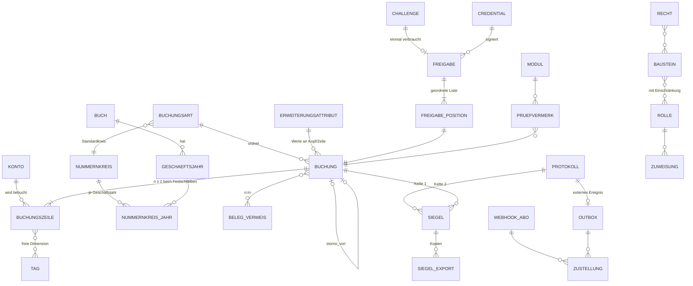

# Abstraktes Datenmodell des Kerns (Projektschritt 1), Fassung 3.2

Status: Fassung 3 **freigegeben am 2026-11-13**, umgesetzt in Kern 0.2.0. Fassung 3.1 ergänzt den **Beitrag zur Jahressperre** (F75 Nr. 11, Kern 0.3.0). Fassung 3.2 ergänzt Merkmale der Rechte, Art der Rolle und den **Empfänger** (Kern 0.4.0).
Grundlage: AGENTS.md, F1 bis F72. Neu in Fassung 3 ist das zweite Review (F66 bis F72): Vorbereitung vor Freigabe, gespeicherte Stapelliste, WebAuthn-Vertrag, Restore-Erkennung von außen, Übergang Test → Produktiv, Idempotenz und Sperrreihenfolge, Verteilung der Prüfpflichten.

Geltungsbereich: **eine Mandanten-Datenbank** (F34), Schema `kern`. Module legen ihre Daten in eigenen Schemas ab (F44).
Nicht Teil dieses Modells sind die Verwaltungsdatenbank (F37; beschrieben in ANWENDUNG.md Abschnitt 6, umgesetzt in `db/verwaltung/`) und der Signierdienst (F15).

---

## 1. Überblick

| Gruppe | Entitäten |
|---|---|
| A. Stammdaten | Buch, Konto, Tag, Buchungsart, Nummernkreis, Nummernkreis-Jahr, Geschäftsjahr, Modul, Erweiterungsattribut |
| B. Buchungen | Buchung (Kopf), Buchungszeile, Zeile↔Tag, Erweiterungswerte, Prüfvermerk, Belegverweis |
| C. Freigabe | Credential, Challenge, Freigabe, Freigabe-Position |
| D. Nachweis | Protokoll (Kette 2), Kettenkopf, Siegel, Siegel-Export, Restore-Prüfung |
| E. Integration | Outbox, Webhook-Abo, Zustellung, Idempotenz |
| F. Rechte | Recht, Baustein, Rolle, Zuweisung |

---

## 2. Entitäten

### A. Stammdaten

**Buch**: genau eine Zeile je Datenbank (F34)
- Name, **Buchwährung** (ISO 4217, F11; unveränderlich ab der ersten Festschreibung), Stempelabstand (Standard 15 Min., F28), Sprache
- **Betriebsart**: Test oder Produktiv (F59; der Wechsel zu Produktiv ist einmalig und nicht umkehrbar)
- **Zugriffszustand**: normal oder Lesemodus (F60, z. B. nach einem Restore bis zur bestandenen Prüfung)

**Konto** (F2, F5, F7)
- Kontonummer (eindeutig, Text), Bezeichnung, **Kontoart** (Aktiv / Passiv / Aufwand / Ertrag), aktiv ja/nein
- Die Kontoart ist nur änderbar, solange keine festgeschriebene Buchung das Konto nutzt. Konten werden nie gelöscht.

**Tag** (F8, F51): Name (eindeutig), Herkunft (manuell / paperless), Paperless-ID (optional)

**Buchungsart** (F25): Kürzel, Bezeichnung, Standard-Nummernkreis

**Nummernkreis** (F25): Kürzel, Bezeichnung

**Nummernkreis-Jahr** (F25)
- Nummernkreis × Geschäftsjahr: Formatvorlage, Regel zum Zurücksetzen (neu oder fortlaufend), Startwert, **Zählerstand**
- Unveränderlich ab der ersten Vergabe.

**Geschäftsjahr** (F33, F36, F65)
- Kennung, **Beginn und Ende frei konfigurierbar** (abweichendes Wirtschaftsjahr, Rumpfgeschäftsjahr)
- Zeiträume ohne Überschneidung und lückenlos aneinander anschließend
- Status: offen / gesperrt; mehrere Jahre dürfen gleichzeitig offen sein

**Modul** (F44, F72): Registry der aktiven Module mit Name, Version, aktiv ja/nein und Erweiterungspunkten (z. B. „Festschreiben prüfen“). Die Datenbank nutzt sie, um vorgeschriebene Prüfvermerke zu verlangen.

**Beitrag zur Jahressperre** (F75 Nr. 11, Fassung 3.1): Geschäftsjahr × Modul → Modulversion, Hash des Moduldatenstands, gesetzt am/von. Pflicht für jedes aktive Modul mit Erweiterungspunkt `gj_sperren_beitrag`, Teil des Sperrinhalts, nach der Sperre unveränderlich.

**Erweiterungsattribut** (F58): die Registry der von Modulen angemeldeten Zusatzfelder
- Schlüssel mit Namensraum (z. B. `steuer.satz`), Modul, Ebene (Kopf / Zeile), Datentyp (Text, Datum, Dezimal-String, Ganzzahl, Wahrheitswert, Auswahl), Pflicht beim Festschreiben ja/nein

### B. Buchungen

**Buchung**, der Kopf (F26)

| Attribut | Pflicht | Hinweis |
|---|---|---|
| ID (UUID) | ja | |
| Buchungsart, Nummernkreis | im Entwurf nein, beim Festschreiben ja | F62 |
| Status | ja | entwurf / **freigabebereit** / festgeschrieben (F66) |
| Belegdatum, Buchungsdatum | beim Festschreiben | das Buchungsdatum bestimmt das Geschäftsjahr |
| Belegnummer | nein | Freitext |
| Text | beim Festschreiben | |
| Herkunft, Herkunftsreferenz | ja / nein | |
| Storno von | nein | eindeutig |
| erfasst am/von | ja | |
| *bei festgeschriebenen Buchungen:* | | |
| Journalnummer | ja | Kette 1, lückenlos, endlos |
| Nummer (Zahl + formatiert) | ja | je Kreis lückenlos |
| festgeschrieben am/von | ja | |
| **Freigabe** | ja (im Produktivbetrieb) | Verweis auf die Freigabe (C) |
| vorbereitet am/von | bei freigabebereit | F66 |
| **Freigabe-Hash** | ab freigabebereit | RFC 8785 über den eingefrorenen Inhalt **ohne** Kettenfelder |
| Vorgänger-Hash, Hash | ja | Hash = SHA-256(Vorgänger-Hash ‖ JCS(Inhalt + Freigabe-Hash + Freigabe-Signatur)) |

**Buchungszeile** (F4, F12, F24)
- Position, Konto, Seite (S/H), Betrag (> 0); optional die Fremdwährungsangaben (alle Angaben zusammen)
- In Entwürfen dürfen einzelne Angaben fehlen (F62).

**Zeile ↔ Tag** (F8)

**Erweiterungswert** (F58): Buchung (bzw. Zeile) × Erweiterungsattribut → Wert
- Wird beim Festschreiben vom Modul geprüft (synchroner Erweiterungspunkt, F46).
- Ist **Teil des Inhalts und damit des Hashes**.
- Werte, die auf veränderliche Stammdaten verweisen, werden als Momentaufnahme gespeichert (z. B. `steuer.schluessel` **und** `steuer.satz`).

**Prüfvermerk** (F72): Buchung × Modul → Modulversion, Erweiterungspunkt (anreichern / prüfen), Ergebnis, Zeitpunkt. Ohne einen positiven Prüfvermerk jedes aktiven Moduls mit „Festschreiben prüfen“ lehnt die Datenbank das Festschreiben ab. Prüfvermerke werden Teil des Hashes.

**Belegverweis** (F10, F27)
- Buchung, Paperless-ID, MD5, SHA-256, zugeordnet am/von, Art (bei Festschreibung / nachgereicht)
- Belege „bei Festschreibung“ sind Teil des Inhalts. Nachgereichte Belege stehen im Protokoll. Ein Verweis wird nie entfernt.

### C. Freigabe (F38)

**Credential**: ein registrierter Passkey oder YubiKey eines Nutzers bzw. der Schlüssel eines API-Clients
- Subjekt (Nutzer- oder Client-ID), Credential-ID, öffentlicher Schlüssel, Algorithmus, Bezeichnung (z. B. „YubiKey Büro“)
- registriert am, widerrufen am
- Registrierung und Widerruf sind Protokollereignisse. Ein Credential wird nie gelöscht.

**Challenge** (F68): eine vom Server ausgegebene, **einmal verwendbare** Anforderung
- ID, einmaliger Zufallswert (≥ 32 Byte), Ablaufzeit (Standard 5 Min.), Mandant, Art der Handlung, Subjekt, Inhalts-Hash
- Challenge-Wert = SHA-256(JCS der vorgenannten Daten)
- verbraucht am (gesetzt beim ersten Gebrauch; danach unbrauchbar)

**Freigabe**: **eine** Signaturhandlung des Nutzers
- ID, Art (Festschreibung / Storno / Geschäftsjahr sperren / Wiederöffnen / Notfall / Produktivbetrieb / Restore-Bestätigung)
- Subjekt, Credential, Zeitpunkt
- **Inhalts-Hash**: bei einer einzelnen Buchung deren Freigabe-Hash; bei einem Stapel der Hash über die geordnete Freigabe-Positionsliste (F67)
- Verweis auf die verbrauchte **Challenge**
- WebAuthn-Assertion (authenticatorData, clientDataJSON, Signatur), Signaturzähler
- Prüfergebnis der Anwendung (Origin, RP-ID, UP, UV, Signatur, Zähler; F68)

**Freigabe-Position** (F67): Freigabe × Position → Buchungs-ID, Freigabe-Hash der Buchung. Damit ist der Stapel vollständig und unabhängig nachprüfbar.

Die Signatur liegt **einmal** in der Freigabe. Jede Buchung verweist darauf und steht mit Position und Freigabe-Hash in der Positionsliste. Der Ketten-Hash jeder Buchung schließt die Freigabe-ID, den Inhalts-Hash und die Signatur ein.

### D. Nachweis

**Kette 1, Buchungen**: festgeschriebene Buchungen in Journal-Reihenfolge.

**Protokoll (Kette 2)** (F48)
- laufende Nummer, Zeitpunkt (UTC), Ereignistyp, Subjekt, betroffene IDs
- **Vorher-Stand** und **Nachher-Stand** (vollständig, z. B. der ganze Entwurf vor und nach der Änderung). Bei festgeschriebenen Buchungen genügt der Verweis.
- optional ein Verweis auf eine Freigabe
- Vorgänger-Hash, Hash

**Kettenkopf**: je Kette die letzte Nummer und der letzte Hash; beim Anhängen gesperrt

**Siegel** (F14, F28): Kette, bis Glied, Ketten-Hash, Systemsignatur, Fingerabdruck, Zeitstempel-Token, Zeitstempeldienst, Status. Jedes Feld wird nur einmal befüllt.

**Siegel-Export** (F35): Siegel, Ziel, Status, Versuche, erledigt am

**Restore-Prüfung** (F60)
- Zeitpunkt, Ergebnis je Prüfschritt (Ketten, externe Siegel, Belege, Schlüssel)
- erkannte Lücke ja/nein: letztes externes Siegel mit Glied-Nr. und Hash
- Bestätigung (Verweis auf die Freigabe)

### E. Integration (F21, F48)

**Idempotenz** (F71): Subjekt, Schlüssel (eindeutig je Subjekt), Endpunkt, Anfrage-Hash, Antwortstatus, Antwortinhalt, Ablauf. Gleicher Schlüssel mit anderem Anfrage-Hash ergibt Fehler 409.

**Outbox**: Verweis auf den Protokolleintrag, Ereignistyp, **schmaler Inhalt** (nur IDs)
**Webhook-Abo**: URL, Ereignisfilter, Verweis auf das Geheimnis, aktiv
**Zustellung**: Abo × Outbox-Eintrag, Status, Versuche, nächster Versuch

**Empfänger** (Fassung 3.2): Modul → Lesestand in der Outbox (höchste verarbeitete Protokollnummer). Für Module, die Ereignisse im selben Prozess verarbeiten (F46).

### F. Rechte (F41–F43, F63), im Mandanten

**Recht** (Code `modul.ressource.aktion`; Merkmale ab Fassung 3.2: berührt Buchungsdaten, schreibend, Notfall), **Baustein**, **Rolle** (mit Bausteinen und Einschränkungen je Baustein; Art ab Fassung 3.2: normal, verantwortlich, prüfer, administrator), **Zuweisung** (Subjekt, Rolle, gültig von/bis). Die Invarianten aus F43 folgen aus Art und Merkmalen.

---

## 3. Querschnittsregeln

1. **Schreiben nur über Datenbankfunktionen** (F64). Jede Funktion schreibt ihr Protokoll in derselben Transaktion.
2. **Unveränderlichkeit**: Festgeschriebene Buchungen samt Zeilen, Tags, Erweiterungswerten und Belegen „bei Festschreibung“ sind nach dem Schreiben unveränderlich, ebenso Freigaben, Protokoll und Siegelinhalte. Das wird doppelt abgesichert, über Rechte und über Trigger.
3. **Entwürfe sind frei** (F62). Die Prüfung erfolgt beim Festschreiben, in dieser Reihenfolge:
   - Regeln des Kerns
   - Erweiterungspunkte der Module (F46)
   - Prüfung der Freigabe-Signatur
   - Nummern vergeben
   - Hash bilden
4. **Zwei Ketten**, getrennt gesiegelt.
5. **Kanonische Form nach RFC 8785 in der Datenbank**: nur Zeichenketten, Ganzzahlen, Dezimal-Strings, Wahrheitswerte und ASCII-Schlüssel, keine Gleitkommazahlen.
6. **Lesemodus** (F60, F69): Ist er aktiv, lehnen alle schreibenden Funktionen ab, außer denen der Restore-Prüfung. Die Anwendung erzwingt ihn zusätzlich von außen, wenn der Kettenkopf hinter der Wasserstandsmarke der Verwaltungsdatenbank oder der externen Siegel liegt. Ein Flag in einem alten Backup reicht also nicht.
7. **Testbetrieb** (F59, F70): Im Testbetrieb ist eine Festschreibung ohne Freigabe-Signatur erlaubt und wird so gekennzeichnet. Der Wechsel in den Produktivbetrieb ist nur bei leerer Kette 1 möglich.
8. **Sperrreihenfolge** (F71): Buch-Zustand → Geschäftsjahr (Festschreiben teilend, Jahressperre exklusiv) → Nummernkreis-Jahr → Kettenkopf 1 → Kettenkopf 2.
9. **Prüfpflichten** (F72): Die Datenbank erzwingt alle strukturellen Regeln einschließlich der Prüfvermerke. Die Anwendung verantwortet Authentisierung, RBAC, die Kryptografie der WebAuthn-Prüfung und die Fachlogik der Module. Alles, was die Anwendung verantwortet, wird nachprüfbar gespeichert.

---

## 4. Ablauf beim Festschreiben (zur Orientierung, noch keine DDL)

1. **Vorbereiten** (eine Transaktion, F66): Kernregeln prüfen; Module **reichern an** und prüfen, wobei jedes Modul einen Prüfvermerk schreibt; der Inhalt wird eingefroren, der Status wird `freigabebereit`, der Freigabe-Hash wird gebildet.
2. **Anzeige**: Die Oberfläche zeigt genau den eingefrorenen Inhalt. Der Server legt eine **Challenge** an (F68), gebunden an den Inhalts-Hash (bei einem Stapel an die Positionsliste, F67).
3. Der Nutzer berührt den YubiKey bzw. bestätigt den Passkey. Der Browser sendet die Assertion.
4. Die **Anwendung** prüft die Assertion kryptografisch (Origin, RP-ID, UP, UV, Signatur, Zähler) und das Recht (RBAC).
5. **Festschreiben** (eine Transaktion, Sperrreihenfolge nach F71):
   - Lesemodus und Betriebsart prüfen
   - Challenge sperren, Ablauf und Einmaligkeit prüfen, als verbraucht markieren
   - Credential gehört zum Subjekt und ist nicht widerrufen
   - Inhalt **neu hashen**; weicht er vom Freigabe-Hash ab, wird abgebrochen
   - Module **prüfen nur** (kein Anreichern); die Prüfvermerke aller aktiven Pflichtmodule müssen vorliegen
   - Geschäftsjahr teilend sperren und Status prüfen; Zähler sperren und Nummern vergeben; Ketten-Hash bilden
   - Freigabe und Positionen speichern, Protokoll und Outbox schreiben
6. Nach dem Commit: Ereignisse zustellen; das nächste Siegel deckt die Buchungen ab; die Verwaltungsdatenbank führt die Wasserstandsmarke nach (F69).

---

Wenn dieses Modell freigegeben ist, folgt die **DDL**: Tabellen, Constraints, Rollen und Rechte, Trigger sowie die Funktion für die kanonische Form, zuerst ohne die eigentlichen Schreibfunktionen. Getestet wird gegen PostgreSQL.
